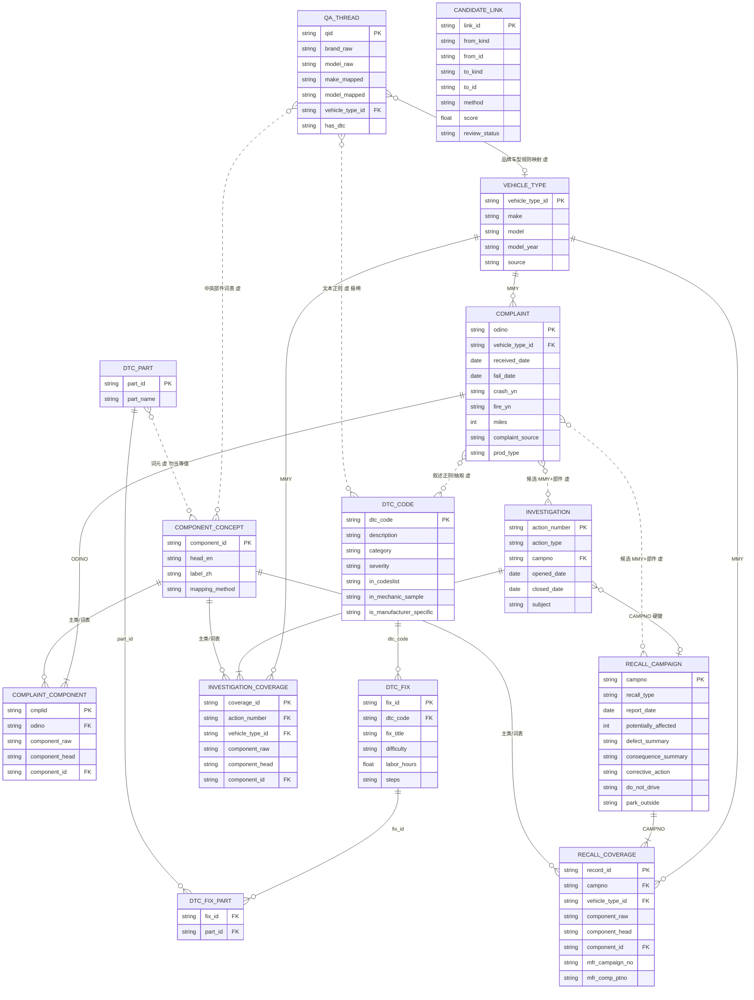

# 演示用关系完整库方案（公开数据，能力从数据推导）

- 日期：2026-11-24（Asia/Shanghai）
- 目的：在脱敏 OEM 样本尚未到位前，用已核实的公开数据搭一套**可串联**的演示库，用来展示「从数据推导出的能力」。本文件只是方案与实测，**不建正式库、不写生产代码**；搭建需维护者确认。
- 探查范围：官方 NHTSA 投诉两个近年包（接收日 2020–2024、2025–2026，非全历史）、召回预/后 2010 全量、缺陷调查全量；CodesList OBD-II 码表；MechanicDB 免费样本；`wushan/vehicle_qa` 中文问诊。表头与字段字典请按 [README](../README.md) 与 [PUBLIC-DATASETS-HF.md](PUBLIC-DATASETS-HF.md) 中的直接链接下载到本地 `data/raw/`（不提交到 git）。匹配率 JSON 在 `docs/stats/join-stats.json`。
- 隐私：投诉中的 `VIN`（字典字段 15，11 位）、城市州、经销商、车辆操作人、叙述原文**不进入演示库，文档只写字段名**。本方案的演示库默认不落 VIN 列。

---

## 1. 结论（先看这里）

NHTSA 三张官方表**没有**投诉号到召回号的硬外键。能稳定串起来的硬键只有：

- 调查 `CAMPNO` → 召回 `CAMPNO`（有召回号的调查里，**93.69%** 能在召回全表找到；全部调查里只有 **28.95%** 带召回号——其余尚未或并未导致召回）。
- 投诉多行靠 `ODINO` 归并；召回多行靠 `CAMPNO` 归并；调查多行靠行动号归并。
- DTC 码表与 MechanicDB 样本按故障码精确对齐：**89.89%**（80/89 个样本码在 CodesList 中）。

投诉 ↔ 召回 / 调查要靠 **年款车型（MAKE + MODEL + YEAR，下称 MMY）** 和 **部件描述** 做候选关联，不是已证实的「这条投诉就是这次召回」：

- 2020–2026 接收的投诉里，有完整 MMY 的行中 **95.46%** 能在召回全表找到同一 MMY（松散车型名几乎不提升，95.48%）。这只说明「该年款车型曾经有过召回」，不能单独当追溯证据。
- 在同一 MMY 已命中召回的前提下，部件全文精确相同仅 **8.47%**；用部件主类（冒号前，如 `ENGINE` / `STEERING`）可升到 **33.18%**（按投诉号 `ODINO` 则是 11.89% / 42.41%）。
- 同一 MMY 能对上调查的投诉行为 **66.34%**；其中部件主类对齐 **29.09%**。

中文 `vehicle_qa` **几乎没有故障码**（0.22% 行），不能靠 DTC 硬连。能连的是规则映射：品牌对上 NHTSA 厂家 **67.86%**，品牌+车型 **32.43%**；用中英部件词表能给 **82.64%** 的问诊打上 NHTSA 部件主类。零件名与 NHTSA 部件描述 **0 条精确相等**，只有词元重叠（88.54%），要当弱提示。

因此：演示库应分成「硬关系」与「候选关系」两层。硬关系可直接展示；候选关系必须带匹配方法与置信度，切片内再人工抽检一套金标准，避免把「同车型有过召回」演示成「该投诉已定性」。

推荐最小切片：**本田 CR-V + 本田雅阁（ACCORD），先以 2018 年款为核心**（近年投诉 4,804 行 / 3,210 个投诉号；2018 CR-V 有 5 个召回活动、3 个调查，雅阁 6 个活动、2 个调查）。中文问诊侧有「本田 CR-V」94 条、「雅阁」207 条。若希望故事更完整，可扩到 2017–2019（9,245 行 / 6,156 个投诉号）。不选投诉量最大的 F-150 做首切，是因为中文问诊几乎对不上（「福特 F-150」仅 4 条）。

---

## 2. 实测匹配率

口径：投诉只用官方五年分包（接收日 2020–2026），共 **635,872** 行、**437,240** 个 `ODINO`、**12,612** 个有效 MMY；其中产品类型几乎都是车辆（`V` 627,121）。召回是 1967 年起全量：**330,296** 行、**30,483** 个 `CAMPNO`、**77,934** 个 MMY。调查是 1972 年起全量：**154,505** 行、**5,361** 个行动号。匹配率是本窗口对全量召回/调查，不是「全历史投诉」的估计。测量时间 2026-11-24，Asia/Shanghai。原始计数见 `public-data/join-stats.json`。

### 2.1 NHTSA 三表

| 连接键 | 怎么连 | 实测 | 含义 |
|---|---|---|---|
| `INV.CAMPNO` = `RCL.CAMPNO` | 硬键（调查结果召回） | 非空调查召回号 2,826 个，其中 **2,453（86.80%）** 出现在召回表；按行动号：5,361 个调查里 **1,552（28.95%）** 带召回号，带号者 **93.69%** 能对上召回 | 这是三表里唯一接近外键的官方键。未命中的 373 个号可能是格式/设备类或历史残缺，演示时要留下未匹配清单 |
| 投诉 `ODINO` → 召回 `CAMPNO` | **不存在** | — | 投诉字典无召回号、无调查号。不能假装有 FK |
| MMY 严格（厂家+车型+年款，已做空格/别名规范化） | 集合重叠 | 投诉 MMY 的 **79.55%**（10,033/12,612）出现在召回；**33.86%** 出现在调查；三表共有 **3,883** 个 MMY（占投诉 MMY 的 30.79%） | 年款车型是主薄弱键，召回覆盖面比调查宽 |
| 同上，行级（2020–2026 投诉） | 有有效 MMY 的 626,555 行 | 命中召回 MMY **95.46%**；命中调查 MMY **66.34%**。车型名去掉空格/连字符后召回命中仅升至 95.48% | 近年热门车型几乎都有过召回，MMY 单独命中**过宽** |
| 同上，投诉号级 | 437,240 个 `ODINO` | 至少一行 MMY 在召回中：**95.14%**；在调查中：**66.29%** | 与行级一致 |
| 同一 MMY 下部件全文精确相等 | `COMPDESC` = `COMPNAME`（规范化大小写） | 已在召回 MMY 内的投诉行：**8.47%**；已在调查 MMY 内：**18.37%**。按投诉号对召回：**11.89%** | 可用，但覆盖窄；精确字符串常被子部件写法拆散 |
| 同一 MMY 下部件主类 | 按 `:` / `;` 取头部（如 `STEERING`） | 对召回行级 **33.18%**，投诉号级 **42.41%**；对调查行级 **29.09%** | 演示追溯的主推荐键：MMY + 部件主类，标记为候选 |
| 部件词表全局（不限车型） | 投诉 719 种部件描述 | 与召回精确交集 **80.25%**；与调查 **54.66%**；主类 49 个中 40 个（**81.63%**）与召回主类重合 | 词表本身是对齐的，缺的是「同车 + 同部件」共现 |

调查行动号前缀（供切片解释调查阶段）：PE 2,332，EA 1,934，DP 512，RQ 248，SQ 159，EQ 85，AQ 43 等。

### 2.2 DTC 码表 ↔ MechanicDB ↔ 投诉叙述 ↔ 中文问诊

| 连接 | 实测 | 含义 |
|---|---|---|
| CodesList `code` = MechanicDB `dtc_code` | 样本 89 个唯一码中 **80（89.89%）** 在码表；反向只占码表 9,414 的 **0.85%** | 样本几乎都是通用码，能硬连码表；完整维修路径只有约 90 个码，覆盖面小 |
| MechanicDB 零件名 = NHTSA 部件描述 | 157 个零件名中精确相等 **0**；词元重叠 **88.54%** | 不能靠等值连接。要经「故障码 → 步骤/零件」走，或经人工/词表把零件归到部件主类 |
| 投诉叙述中的 DTC 正则 `\b([PCBU][0-9A-Fa-f]{4})\b` | **2.29%** 行（14,545/635,872），**9,187** 个投诉号；抽出 2,588 个不同码 | 硬连存在但稀疏。抽出码的 **48.96%** 在 CodesList；至少有一个码在码表中的投诉号占「含码投诉」的 **74.15%**。在 MechanicDB 样本中的码只有 **3.13%** |
| 高频码示例（只列代码，不列叙述） | `P0300`–`P0304`、`P0420` 在码表与 MechanicDB 中；最高频 `P1326`（580 行）**不在**通用码表（典型厂标码） | 演示要把厂标码单独搁「未入词表」，不要丢弃也不要硬挂通用定义 |
| `vehicle_qa` 文本中的 DTC | **28/12,943 行（0.22%）**，51 个不同码，其中 38 个（74.51%）在 CodesList | 中文问诊几乎不能靠故障码接到码表。这是断开的硬关系 |
| 中文品牌 → NHTSA `MAKE`（规则表，如 本田→HONDA） | **67.86%**（8,783 行） | 可用。未映射主要是吉利、比亚迪、长安、奇瑞、哈弗、五菱及空品牌等，本来就不在 NHTSA |
| 中文品牌+车型 → NHTSA MMY 的车型侧（无年款） | **32.43%**（4,198 行） | 雅阁/CR-V/卡罗拉/凯美瑞/途观等能对；朗逸、速腾、凌派、福睿斯等中国特有车型对不上年款车型表 |
| 中文问诊文本 → NHTSA 部件主类（保守中英词表，如 刹车→SERVICE BRAKES） | **82.64%** 行至少命中一类；发动机相关最高（「ENGINE」4,884，「ENGINE AND ENGINE COOLING」4,598） | 这是中文问诊接入演示图的主通道，属于规则映射，一词可多类，需抽检 |

MechanicDB 样本结构（已读 parquet，未把内容写入仓库）：90 行码（75 通用 + 15 厂标）、326 条修复步骤、449 行零件。`system_category` 以 Powertrain 为主（84）。厂标码涉及 BMW/Chevrolet/Ford/Toyota/Honda 等，数量极少。

---

## 3. 实体-关系图

实线：官方或数据集内硬键。虚线：候选关系（必须带来源方法与置信度）。

`CANDIDATE_LINK` 容纳所有虚线：投诉→召回、投诉→调查、问诊→部件、叙述→DTC。`review_status` 取未审 / 抽检通过 / 抽检否定。演示查询默认只展示「硬键 + 抽检通过的候选」。

### 3.1 实体清单（主键、连接、来源、行数估计）

| 实体 | 主键 | 主要连接字段 | 来源 | 全量/窗口估计 | 最小切片估计（本田 CR-V+雅阁 2018） |
|---|---|---|---|---|---|
| `VEHICLE_TYPE` | `(make, model, year)` 规范化码 | — | 三表 MMY 去重 | 窗口投诉 12,612；召回 77,934；三表共有 3,883 | 2 个年款车型（扩 2017–2019 则为 6） |
| `COMPLAINT` | `ODINO` | `vehicle_type_id` | NHTSA CMPL，按 `ODINO` 折叠 | 窗口 437,240 | 约 3,210（2017–2019 约 6,156） |
| `COMPLAINT_COMPONENT` | `CMPLID` | `ODINO`，`COMPDESC` | CMPL 行 | 窗口 635,872（全历史第三方曾计约 225 万行，本次未下载全包） | 约 4,804（2017–2019 约 9,245） |
| `RECALL_CAMPAIGN` | `CAMPNO` | — | RCL 按活动去重 | 30,483 个活动 | 2018：CR-V 5 + 雅阁 6（约 11；扩年款会增加） |
| `RECALL_COVERAGE` | `RECORD_ID` | `CAMPNO`，MMY，`COMPNAME` | RCL 行 | 330,296 | 切片年款覆盖行（数百级，搭建时再精确计数） |
| `INVESTIGATION` | 行动号 | 可空 `CAMPNO` | INV 去重 | 5,361 | 2018：CR-V 3 + 雅阁 2（约 5） |
| `INVESTIGATION_COVERAGE` | 代理键 | 行动号，MMY，`COMPNAME` | INV 行 | 154,505 | 切片覆盖行（数十级） |
| `COMPONENT_CONCEPT` | 主类码 | 中英文标签 | 从 NHTSA 主类归纳 + 中文词表 | 投诉侧主类约 49 | 沿用同一词表 |
| `DTC_CODE` | `dtc_code` | — | CodesList + 叙述中出现但不在表内的厂标码 | 码表 9,414；窗口叙述另见 2,588 个抽出码（约半数不在表内） | 切片叙述中实际出现的码 + 其码表定义 |
| `DTC_FIX` / `DTC_PART` | `fix_id` / `part_id` | `dtc_code` | MechanicDB 样本 | 326 步骤、157 个零件名 | 仅当切片出现的码落在 89 个样本码内 |
| `QA_THREAD` | `QID` | 映射后的 make/model（通常**无年款**） | vehicle_qa | 12,943 | CR-V 94 + 雅阁 207，合计 301（可加思域 89 作对照） |
| `CANDIDATE_LINK` | 代理键 | `method, score, review_status` | 派生 | 视规则生成 | 切片内生成后人工抽检几十到一两百条作为金标准 |
| `MAKE_MODEL_MAP` | 中文品牌/车型 | 英文 MAKE/MODEL | 本次规则表（可扩展） | 当前规则覆盖问诊的 67.86% / 32.43% | 本田及雅阁、CR-V、思域等 |

演示库**不建** VIN、经销商、操作人、原文叙述等列。若演示「现象」文本，只用抽检通过的去标识短摘录，或只用部件主类与结构化字段。

---

## 4. 断开的关系与补法

| 断开点 | 现状 | 补法 | 风险 |
|---|---|---|---|
| 投诉没有 `CAMPNO` / 调查号 | 官方就不写这根键 | 派生候选：同一 MMY + 部件主类（行级约 33%）；可选再加日期窗（投诉接收日与召回/调查开案日邻近）。切片内人工抽检后写入 `review_status` | 仅 MMY 会严重误连（95% 都“能连上”）。不得把候选默认显示为已确认 |
| 部件全文不一致 | 精确匹配只有 8.47% | 先用官方层级的主类（已验证能到约三分之一）。进一步可用受控同义词表；不要一上来用无监督聚类当事实 | 主类仍粗（`ENGINE` 过大） |
| 中文问诊无年款、少故障码 | DTC 仅 0.22% | 品牌/车型规则映射 + 部件中英词表（已测 82.64% 能打上主类）。连到「该车型的部件证据池」，不连到某一个 2018 年款投诉 | 中国特有车型对不上；同一中文车型对应多年款 |
| 厂标 DTC（如 `P1326`）不在通用码表 | 抽出码约半数不在 CodesList | 保留码值，标记 `is_manufacturer_specific`；能连 MechanicDB 厂标样本的再挂步骤；其余只展示「叙述中出现该码」 | 不可编造释义 |
| MechanicDB 只有约 90 个码 | 对抽出码覆盖 3.13% | 演示「故障码→维修路径」时，优先选切片里既出现、又在样本中的通用码（如 `P0300`  misfire、`P0420`）。其余只连到码表定义，不假装有步骤 | 路径展示会偏动力总成 |
| 零件名 ≠ 部件描述 | 精确 0 | 零件只挂在 `DTC_FIX` 下，不直接外键到 NHTSA 部件。若要展示，经码的系统类别或人工对照 | 词元重叠不能当等值 |
| 调查无召回号 | 71% 调查没有 `CAMPNO` | 这不是缺失，是业务状态：调查未（或未）导致召回。应作为能展示的能力，而不是补一条假外键 | 不要为了「图完整」填造 CAMPNO |
| 中文问诊叙述与英文投诉叙述 | 无共同键 | 经部件概念对齐后做对照展示；若用 LLM 抽取症状短语，必须抽样人工审，抽检记录进 `CANDIDATE_LINK` | 机翻和幻觉 |

LLM 抽取（可选，不是首切片必做）：从去标识的投诉叙述或中文对话里抽症状短语、DTC、部件。只作为候选，抽检通过才进演示查询。

---

## 5. 这套库能展示哪些「由数据推导」的能力

能力名称从上面的键和覆盖率来，不预设 CAP 目录。首切片建议只演示前四条（有硬键或已测匹配率支撑）；后两条标明证据较弱。

1. **现象 → 部件 → 召回 → 处置的追溯（候选 + 抽检）**  
   从一条投诉的部件主类，列出同一 MMY 下部件主类相同的召回，展示缺陷摘要与纠正措施；若该 MMY 还有带 `CAMPNO` 的调查，沿硬键接到召回。能讲清「如何追溯」，也必须讲清「为何不是官方已确认因果」。

2. **同车型相似投诉一览**  
   同一 `VEHICLE_TYPE` + 同一部件主类下的投诉号列表，可加事故/起火/里程等结构化条件。不依赖召回键，覆盖完整。

3. **调查是否导致召回**  
   用 `INV.CAMPNO` 硬键：有号且能对上召回 / 有号但对不上 / 无号。这是质量域里最干净的官方关系。

4. **故障码 → 定义 → 维修步骤与零件**  
   当叙述或问诊里出现 CodesList 中的码，展示定义；若又在 MechanicDB 样本中，展示步骤、难度、工时、零件。数据已证明这条链在样本码上是硬的，只是稀疏。

5. **中文问诊对照英文投诉/召回证据（弱连接）**  
   雅阁 / CR-V 问诊经品牌车型映射与部件词表，对照同一厂家车型、同一部件主类下的英文投诉与召回文本（文档检索可选用开源 WeKnora）。要明确「无年款、非同一辆车」。

6. **词表未覆盖的厂标码发现**  
   列出叙述中出现但不在通用码表的码（如 `P1326`），作为「数据里长出的词表缺口」，而不是假装已有定义。

暂不作为首切能力：8D 闭环、保修工单金额、寻车 App 反馈、原始 CAN——公开数据仍盖不住。

---

## 6. 怎样落到 v3.0 栈

与 `ONTOLOGY-TECH-STACK-v3.md` 一致：先剖析再建模，不预写能力类目录。

1. **剖析（本文件已做第一轮）**：键、缺失、匹配率、切片规模。同意搭建后，工程只对切片再做一次字段级剖析（枚举值、空值率），报告仍不出现 VIN 取值。
2. **LinkML 1.12.1** 按上表实体手写 YAML（唯一源）。属性来自实测列，不从 v2.5 备份拷贝类名。候选关系做成带 `method` / `score` / `review_status` 的关联类，避免 OWL 里出现过强的必然因果。
3. 生成器产出 **Turtle**（主发布）、SHACL、JSON Schema。CI：ROBOT 1.9.11、HermiT 发布时 DL、pySHACL 0.40.2。运行时仍是 Fuseki 上的 OWL 2 RL。
4. **落地方式建议**：用临时 SQLite/DuckDB 做 ETL 与抽检表（**不是**系统真源，也不进 git）。审过的切片 ABox 序列化为 TTL，与 TBox 一起载入 **Jena Fuseki + TDB2 6.3.0**（Java 21+）。TDB2 目录不进 git。
5. **查询**：能力问题的 SPARQL 在切片数据和抽检完成后再写，不预写查询内容。业务应用需要时只读 SPARQL；流程数据仍留在应用库。
6. **检索（可选，WeKnora v0.9.0）**：召回纠正措施、调查摘要、抽检通过的去标识问诊或现象短文本可作为检索文档；命中必须带知识库 id，并链回演示库里的 `campno` / `odino` / `qid`。没有库 id 的命中丢弃，不提升证据级别。
7. IRI 仍按已锁定政策 `https://w3id.org/poc-kb/{module}/{kind}/{code}`；演示个体用非识别性代码（活动号、调查号可用官方公开号；投诉号是 NHTSA 内部序号，演示可用哈希或切片内代理号，避免把完整叙述与号一并外传）。

---

## 7. 最小可演示切片

**建议（优先）：本田 `CR-V` + `ACCORD`（雅阁），年款 2018，必要时扩到 2017–2019。**

理由（均为实测，不是预设）：

- 两车型在投诉、召回、调查三表都有共现；2018 年款本身就在「三表共有 MMY」且投诉量大（CR-V 2,214 行 / 1,588 个投诉号，5 个召回、3 个调查；雅阁 2,590 行 / 1,622 个投诉号，6 个召回、2 个调查）。
- 合计 2018：**4,804 行、3,210 个投诉号、约 11 个召回活动、约 5 个调查**——足够把每条召回和调查在演示里讲完，又不至于变成全库。
- 中文问诊对得上：本田 CR-V 94、雅阁 207。对比：投诉量最大的福特 F-150 在问诊里只有 4 条，不适合「中英对照」首切。
- 思域（问诊 89 条）可作第二对照车型，不必进入第一刀。

扩窗 2017–2019：9,245 行 / 6,156 个投诉号，仍可演示，召回/调查条数会增加。2016–2020 共 11,105 行 / 7,416 个投诉号，建议作为上限，不要再放大。

切片纳入：

- 上述年款车型的投诉（不含 VIN 与联系人，叙述默认不进库，抽检摘录另议）。
- 覆盖这些 MMY 的召回活动及其纠正措施、调查（含有/无 `CAMPNO` 两种）。
- 部件主类词表及中文对照。
- 切片叙述中实际出现的 DTC + CodesList 定义；与 MechanicDB 交集上的步骤/零件。
- 对应中文问诊 301 条及品牌/车型/部件映射。
- 按「MMY + 部件主类」生成的候选链接，加一轮人工抽检（建议先抽 100 条投诉→召回候选：通过 / 否定 / 无法判断）。

演示路径示例（搭建后由工程实现，此处只定范围）：选一条抽检通过的 2018 CR-V 转向或制动投诉 → 看同车型同类投诉 → 看同主类召回与纠正措施 → 若调查带 `CAMPNO` 则沿硬键接通 → 若叙述含 `P0300` 一类样本码，再打开维修步骤。旁路一条雅阁中文问诊，经部件词表对照到同类英文证据。

---

## 8. 需要确认的点

1. **首切车型**：是否同意 **本田 CR-V + 雅阁，2018 为核心**（或扩 2017–2019）？若更想看投诉量，可改福特 F-150，但基本放弃中文问诊对照。
2. **候选关系的展示政策**：是否接受「默认只展示硬键 + 抽检通过的候选」，并把「同 MMY 即关联」视为过宽、不作自动确认？
3. **第一刀是否包含中文问诊**：包含则能展示中英对照，但关系是规则映射、无年款；也可第一刀只做 NHTSA + DTC，问诊放第二刀。
4. **现象文本**：演示库是否完全不存投诉/问诊原文（更安全，展示靠结构化字段与召回官方摘要），还是允许去标识短摘录进抽检集？
5. **许可证**：NHTSA 源为美国政府公有领域；CodesList 为 CC-BY-4.0（需署名）；MechanicDB 样本为 ODbL（派生库再分发有 share-alike）。演示若对外，需要确认这三项都可以。
6. **确认后才搭建**：本方案不建库。确认后的路径：切片 ETL（临时库）→ LinkML → TTL → Fuseki，并做候选链接抽检。

---

## 9. 探查方法与文件

- 官方字典请从 [README 的 NHTSA 链接](../README.md#美国-nhtsa公有领域) 下载：`CMPL.txt`、`RCL.txt`、`INV.txt`。
- 匹配率：`docs/stats/join-stats.json`（计数与百分比，无车辆识别号、无叙述）。
- 码表请从 https://huggingface.co/datasets/CodesList/obd2-codes 下载（CC BY 4.0，需署名；不要提交到本仓库）。
- 投诉与调查/召回全量平面文件请下载到本地 `data/raw/`，**不要提交到 git**。直接链接见 [README](../README.md) 与 [PUBLIC-DATASETS-HF.md](PUBLIC-DATASETS-HF.md)。
- 规范化：厂家别名（如 VW→VOLKSWAGEN、CHEVY→CHEVROLET）；年款 `9999` 视为无效 MMY；部件主类取首段。
- 中文规则表是本次探查用的保守词表，不是已发布本体；同意搭建后应固化并抽样复核。
